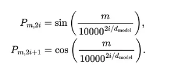
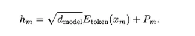
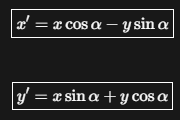

Note for writing down things encountered from outside of d2l book.

YT channels
Vizuara
StatQuest

1. t-test, p-value, central limit theorem 

- The great mental models of artificial intelligence series
    1. Gradient Handoff - when you can't write a rule, describe the goal and let the gradient find it.
    - matches with first AI intro note. Let the data find their way to output rather than we human paving the path.

    2. Build the hunger, not the skill -optimize a humble little task; the real understanding arrives as a side effect.
    - focus on core need rather than how to and where to. Rather than supplying fish or even teaching fishing, teach HUNGER. and let them come up with technics.

    3. Vectors - it showed importance of vectors. How they live under very complex models that feels almost magical. But under the hood it's just vectors. They are like alphabets. We can convert all media formats into vectors. It also demonstrated importance of tokenization and vectorization. They are pre-requisite parts of ML but often they are shadowed by more "cool" parts of ML.

    4. Compression of data and projecting it back to original size
    - This one feels strange as the usecase of this has not been encountered yet. But it says at many places (stable diffusion models, Deepseek, LoRA, etc) - they all do this where they compress data while not loosing the features to accomodate with GPU capacities and after the processing done they project it back.
    - It feels counter-inuitive but he showed that sometimes not all data are required. We can compress while not loosing features, we do processing at bottle-neck and then expand it back to real form.
    - I have yet to see this in action.

    5. Expressivity
    - This is about increasing of dimension for the same amount of features. Features count remains same while number of dimensions increases, result? Model starts picking up more patterns. here it feels a bit mysterious and magic like. Only because more than 3 dimensions feel hard to visualize.
    - Somewhere this relates to VC dimension topic. When it is hard to draw a dividing line in n-d space, project it on (n+1)d space. We should be able to divide now.
    - Video mentioned feed forward neural network in LLM where this mental model is applied. yet to see that in action. 

    6. Diffusion - reverse the corruption
    - Introduces to another way of generating things. Up until now we saw predictions. How LLM predicts next word. Diffusion is about another way of generating where content is already there but it is with noise. Models are taught to de-noise it and get to the output.
    - In image generation it is already there. However it is less widespread in text generation.

    7. Adverserial Networks - Not yet encountered irl. It showed how models can learn to perform tasks when two models setup is done. first is generator and second evaluator. Or say forger and detective and how both can improve.

    8. Entropy - Explains how concept of entropy imerged from thermodynamics to explain rate of chaos for a group of atoms. (more entropy means more instability.) Later it came in information theory. (entropy is seen in proportion to how surprised I'm with information received. If event with probability 1% takes place -> entropy is high. If a very much expected event happens -> entropy is low.)
    Later it came into AI/ML. especially as seen in softmax -> cross entropy -> loss calc process in classification models. 

    9. Everything is a distribution - 
    Distribution came first time in d2l book while creation of synthetic data for model. Here in video it explained how concepts of distribution and normal distribution are much more than few limited areas. Anything that has no fixed answer and it repeats many times, we can see it as a probability distribution. If it repeats thousands of times, we generally get a bell shaped curve. There should exist an area in statistics and probabilities where this is a central part. 
    Mostly because if there is certainty, we are normally good. we can simply create if else blocks.
    in ML world when it comes to predicting and classifying things. we don't have simple yes/no answer. I suppose probability distributions should play important role here. It should help getting directions/ getting conclusions where the statements are like 'It has 80% CHANCE of happening'

Attempt to understand GPT-2 e2e -> https://www.llm-visualized.com/

1. Token embedding Matrix
- Fetches 768 dimensional vector value for each token from already learned Matrix.
- it is just another learned matrix; we can see it as the first equation in the long chain of equations leading to predictions. So same like others, token embedding matrix will get its gradients via chain rule and during training process the weights will update.

2. Position embedding Matrix
- learned 768-dimensional vector value for each position of input
- additing this to token embeddings give position aware embeddings
- Mathematically not much different from token embedding matrix. Only during training process they start to get their own identities.
- understand this better - RoPE, etc.
- keeping learned position embeddings is one aproach that GPT-2 uses, other than that there are multiple aproaches that rely on pure mathematics.
- Sinusoidal position: this was used in the paper attention is all you need where below formulas were used to get sin and cos values. Imagine multiple clocks. first one running fast - taking big jumps. for this clock we will reach to point zero very soon. if that's the case, add another clock which runs a bit slower and keep repeating this till we cover all dimension size of position embedding matrix. this newly created vector is then simply added to token embedding matrix.

- Next and the most used approach is RoPE (Rotary positional embeddings). here we are not creating a new set of values like the previous two methods but we transform the pairs from Q and K vectors of each token in each attention head into new vectors based on their position and the same clock idea from sinusoidal embedding method. As we are transforming a 2-d vector(each pair) we need 4 values for the operation which comes from below formula

- where alpha is same as value used in brackets in image-12.

3. added values are sent into layer normalization step. 3 processes occure there
   - normalization using mean and variance.
   - elementwise multiplication by a layer level learned parameter gamma
   - elementwise addition by another layer level learned parameter beta